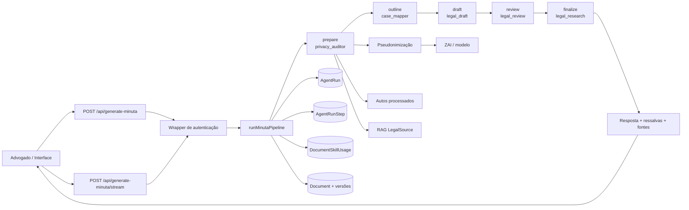

# Arquitetura dos Agentes Jurídicos da JuridIA

**Versão:** 1.0  
**Branch:** `feat/minutaia-parity`  
**Commit de referência:** `8dfdbf1`  
**Escopo:** arquitetura, ciclo de execução, persistência, privacidade, custos, observabilidade e operação dos agentes jurídicos recém-implementados.

> **Regra profissional:** os agentes produzem material auxiliar e rascunhos. Toda minuta, citação, tese ou análise jurídica gerada por IA exige revisão humana antes de protocolo ou uso oficial.

## 1. Objetivos arquiteturais

A implementação busca transformar a geração de minutas em um fluxo auditável, econômico e orientado pelos autos, sem criar chamadas de IA duplicadas. Os objetivos são:

1. separar responsabilidades jurídicas por agente;
2. manter um único orquestrador para geração JSON e streaming;
3. registrar as etapas, agentes, custos técnicos, tokens e resultados;
4. pseudonimizar fatos antes de qualquer chamada ao provedor de IA ou ao Atlas;
5. preservar rastreabilidade de skills, fontes, versões e correções;
6. permitir degradação controlada quando o provedor, o RAG ou o roteador de skills estiver indisponível;
7. manter o humano como aprovador final.

## 2. Visão geral



As duas rotas de geração diferem apenas no observador: a rota de streaming emite eventos SSE e deltas da etapa de redação; ambas executam `runMinutaPipeline()`.

## 3. Catálogo de agentes

O catálogo está em `apps/juridia/src/lib/agent-registry.ts` e é exposto pela rota autenticada `GET /api/agents`.

| Slug | Função | Modo | Entrada principal | Saída | Revisão humana |
|---|---|---|---|---|---|
| `privacy_auditor` | Auditor de privacidade | determinístico | payload e marcadores | relatório de pseudonimização e rastreabilidade | obrigatória |
| `case_mapper` | Mapeador do caso | híbrido | autos pseudonimizados | fatos, eventos, questões e lacunas | obrigatória |
| `legal_research` | Pesquisador jurídico | determinístico | questões e termos jurídicos | referências rastreáveis e dossiê de fontes | obrigatória |
| `legal_draft` | Redator jurídico | LLM | fatos, fontes, skills, estilo e molde | rascunho documental | obrigatória |
| `legal_review` | Revisor de conformidade | híbrido | rascunho e regras | correções e ressalvas | obrigatória |

### Mapeamento entre etapa e agente

A função `agentForStage()` mantém o contrato central:

| Etapa | Agente |
|---|---|
| `prepare` | `privacy_auditor` |
| `outline` | `case_mapper` |
| `draft` | `legal_draft` |
| `review` | `legal_review` |
| `finalize` | `legal_research` |

O catálogo descreve a responsabilidade; a execução concreta continua concentrada no pipeline para evitar duplicação de chamadas e facilitar controle de orçamento.

## 4. Ciclo de execução

### 4.1 `prepare`: entrada, autos e privacidade

1. valida o template pelo `templateSlug`;
2. carrega os `CaseFile` do `caseId` pertencentes ao usuário e com status `ready`;
3. incorpora o texto extraído dos autos ao bloco factual;
4. adiciona, quando existente, o contexto do Cérebro Jurídico;
5. executa `pseudonymize()` antes de encaminhar o conteúdo ao modelo;
6. separa fatos pseudonimizados para roteamento de skills e RAG;
7. seleciona skills manuais e automáticas;
8. consulta a base curada `LegalSource` por meio do RAG leve.

Os autos originais ficam restritos ao fluxo autenticado da JuridIA. O Atlas recebe somente dados públicos/metadados previstos por sua integração.

### 4.2 `outline`: mapeamento estruturado

Quando o provedor está disponível, a etapa solicita plano estruturado em JSON. O resultado esperado é um `CaseOutline`, usado para orientar a redação. JSON inválido ou falha do provedor não interrompe necessariamente o fluxo: a implementação registra a falha e segue com a estrutura clássica, marcando a execução como degradada quando aplicável.

### 4.3 `draft`: redação

A redação usa:

- persona jurídica do pipeline;
- fatos pseudonimizados;
- molde aprovado, limitado a 60.000 caracteres;
- skills manuais e roteadas;
- referências do RAG;
- estilo selecionado;
- perfil de estilo personalizado somente quando aprovado pelo advogado;
- chamada normal ou streaming ao provedor ZAI.

O limite do molde evita multiplicação descontrolada de tokens em lotes.

### 4.4 `review`: conformidade

A etapa revisa o rascunho e aplica correções controladas. O pipeline registra a quantidade de correções e mantém as violações encontradas. São tratados, entre outros:

- citações frágeis;
- marcadores não restaurados;
- desvios do template;
- inconsistências de estrutura;
- ressalvas de conformidade.

### 4.5 `finalize`: restauração, persistência e auditoria

Na finalização:

1. restaura os marcadores localmente;
2. garante que a peça seja marcada como rascunho quando necessário;
3. cria ou atualiza o documento;
4. grava versões persistentes;
5. grava `DocumentSkillUsage` com versão, hash e snapshot da skill;
6. incrementa a cota do usuário;
7. encerra `AgentRun` como `completed` ou `failed` conforme o estado degradado;
8. grava evento de auditoria e lançamento de uso;
9. devolve documento, referências, tokens, estágios e correções.

## 5. Contrato de execução e idempotência

Cada execução cria um `AgentRun` com:

- `agentSlug` principal: `legal_draft`;
- `taskType`: `draft`;
- `inputHash`: hash do template, fatos, skills e molde;
- `userId` autenticado;
- `tokensBudget` de 30.000;
- `providerSnapshot` com provedor, variante do pipeline e catálogo de agentes.

O `inputHash` permite identificar entradas equivalentes e sustenta futuras políticas de idempotência. O schema também prevê `idempotencyKey`, `contractVersion`, `promptVersion`, orçamento monetário e estados de pausa HITL.

## 6. Auditoria de passos

Cada passo chama `recordStep()` e cria `AgentRunStep` com:

- número sequencial;
- tipo (`llm_call`, `tool_call`, `hitl_pause`, entre outros previstos);
- nome composto por agente e etapa, por exemplo `legal_review:review`;
- status (`done`, `error`, `paused` etc.);
- hash do resultado;
- saída JSON truncada a 4.000 caracteres;
- provedor e modelo;
- tokens de entrada/saída;
- duração em milissegundos.

O conteúdo de saída é limitado para reduzir exposição e custo de armazenamento. O hash preserva uma âncora de integridade sem exigir a retenção integral de cada resposta intermediária.

## 7. Persistência relacionada

| Modelo | Finalidade |
|---|---|
| `AgentRun` | execução completa do pipeline |
| `AgentRunStep` | passos individuais e observabilidade |
| `CaseFile` / `CaseFilePage` | autos, páginas, hashes e evidências de extração |
| `DocumentVersion` | histórico persistente do documento |
| `DocumentComment` | comentários ancorados e resolvidos |
| `DocumentSuggestion` | sugestões aceitas/rejeitadas |
| `DocumentSkillUsage` | skill, versão, hash e conteúdo efetivamente aplicado |
| `StyleProfile` | padrão de redação aprendido e aprovação explícita |
| `BatchJob` / `BatchItem` | lotes retomáveis, status e documentos por item |

## 8. Skills e perfil de estilo

As skills podem ser:

- escolhidas manualmente pelo advogado;
- roteadas automaticamente a partir dos fatos pseudonimizados;
- mescladas sem duplicação;
- registradas com origem, versão, hash e snapshot.

O perfil de estilo personalizado não é aplicado automaticamente apenas por existir. Ele precisa estar com `approved = true`. Quando aprovado, o pipeline acrescenta descrição e até três exemplos ao direcionamento de estilo. Isso preserva controle humano e reduz o risco de aprendizado indesejado a partir de documentos não validados.

## 9. Privacidade e segurança

Controles implementados:

1. autenticação antes das rotas protegidas;
2. filtros por `userId` nos autos e perfis;
3. pseudonimização antes do modelo;
4. hash de arquivos e páginas;
5. restrição de arquivos prontos ao caso solicitado;
6. separação entre texto dos autos e contexto do Atlas;
7. auditoria de uso e geração;
8. política explícita de revisão humana;
9. ausência de publicação ou integração automática com sistemas judiciais externos.

Limitação atual: a camada de anonimização ainda está no fluxo da aplicação; uma extensão de navegador com garantia de que o original não deixa o dispositivo é uma evolução posterior.

## 10. Degradação controlada

O pipeline pode continuar com ressalvas quando:

- o roteador de skills não encontra a base de versões;
- o RAG curado está indisponível;
- o provedor de IA não está disponível;
- o JSON de outline é inválido;
- a revisão não consegue ser executada.

A resposta inclui `pipeline.degraded`, status de estágios, violações e notas. Isso impede que uma execução incompleta seja confundida com uma minuta plenamente validada.

## 11. Custos e controle

O desenho prioriza economia:

- um único runner para JSON e streaming;
- catálogo declarativo, sem chamadas extras por agente;
- limite de molde por item de lote;
- orçamento de tokens por `AgentRun`;
- registro de tokens por passo;
- skills roteadas somente quando relevantes;
- RAG limitado a cinco resultados;
- snapshot truncado de saída intermediária.

O campo `costBrl` existe no schema para futura contabilização monetária por execução e passo; o pipeline atual registra principalmente tokens e lançamentos de uso.

## 12. API de agentes

### `GET /api/agents`

Rota autenticada que devolve:

```json
{
  "agents": [
    {
      "slug": "legal_draft",
      "label": "Redator jurídico",
      "mode": "llm",
      "purpose": "Redigir a minuta conforme template, skills, fontes e estilo.",
      "input": "fatos, fontes e molde",
      "output": "rascunho documental",
      "requiresHumanReview": true
    }
  ],
  "policy": "Agentes geram rascunhos auxiliares; revisão humana permanece obrigatória."
}
```

A rota não expõe conteúdo sigiloso, prompts, tokens ou resultados de execuções anteriores.

## 13. Observabilidade da interface

A rota de streaming emite eventos de estágio:

```typescript
type MinutaRunEvent =
  | { type: "stage"; stage: "prepare" | "outline" | "draft" | "review" | "finalize"; status: "start" | "done" | "error" | "skipped"; note?: string; ms?: number; tokens?: number }
  | { type: "draft_delta"; text: string }
  | { type: "done"; result: GenerateMinutaResponse };
```

A interface pode exibir progresso sem criar um segundo pipeline. O evento `done` contém documento, referências, validação, tokens e resumo das etapas.

## 14. Testes e gates

A validação da branch deve executar:

```bash
# JuridIA
./node_modules/.bin/tsc --noEmit
DATABASE_URL='file:./.verify.db' ./node_modules/.bin/next build
DATABASE_URL='file:./.verify.db' ./node_modules/.bin/prisma validate --schema prisma/schema.prisma

# Atlas Forense
pnpm check
pnpm test

git diff --check
```

### Resultado desta branch

| Gate | Resultado |
|---|---|
| `./node_modules/.bin/tsc --noEmit` na JuridIA | aprovado |
| `prisma validate --schema prisma/schema.prisma` | aprovado |
| `./node_modules/.bin/eslint .` na JuridIA | aprovado, sem erros |
| `next build` na JuridIA | aprovado |
| `pnpm check` no Atlas Forense | aprovado |
| `pnpm test` no Atlas Forense | **207/207 testes aprovados** |
| `git diff --check` | aprovado |

O build da JuridIA valida também as rotas `/api/agents`, `/api/case-files`, `/api/documents/export`, `/api/style-profiles` e `/api/batches`. O build emite quatro warnings preexistentes de acesso dinâmico ao sistema de arquivos em `graph-agent.ts`; eles não impedem a compilação.

O script `pnpm lint` não chegou a executar o ESLint porque o wrapper tentou rodar `pnpm install` e foi bloqueado pela política local de scripts ignorados (`ERR_PNPM_IGNORED_BUILDS`). Por isso, o binário local `./node_modules/.bin/eslint .` foi executado diretamente e terminou sem erros.

## 15. Limitações e próximos incrementos

1. criar testes unitários específicos para o catálogo e o mapeamento `agentForStage()`;
2. criar testes de integração autenticados para `GET /api/agents`;
3. adicionar pausa e retomada HITL efetiva, além dos estados previstos no schema;
4. separar a anonimização em extensão/local-first;
5. adicionar conectores independentes para PJe, eproc, SEEU e e-SAJ;
6. substituir o textarea por editor documental rico;
7. registrar custo monetário efetivo por chamada quando o provedor disponibilizar tarifa confiável;
8. ampliar cobertura geográfica e temática do Atlas para Belo Horizonte, Betim, Contagem, Igarapé e demais municípios da Região Metropolitana de Belo Horizonte, preservando a natureza descritiva da jurimetria.

## 16. Arquivos principais

- `apps/juridia/src/lib/agent-registry.ts`
- `apps/juridia/src/lib/minuta_run.ts`
- `apps/juridia/src/app/api/agents/route.ts`
- `apps/juridia/src/app/api/generate-minuta/route.ts`
- `apps/juridia/src/app/api/generate-minuta/stream/route.ts`
- `apps/juridia/prisma/schema.prisma`
- `apps/juridia/src/lib/case-files.ts`
- `apps/juridia/src/app/api/case-files/route.ts`
- `apps/juridia/src/app/api/documents/versions/route.ts`
- `apps/juridia/src/app/api/documents/export/route.ts`
- `apps/juridia/src/app/api/style-profiles/route.ts`
- `apps/juridia/src/app/api/batches/route.ts`
