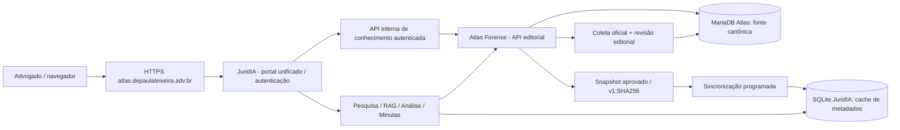

# Atlas Forense + JuridIA — arquitetura da plataforma unificada

**Implementação:** branch `feat/atlas-juridia-plataforma-unificada-20261012`  
**Estratégia:** uma experiência de uso e uma autenticação de usuário, dois serviços internos com responsabilidades claras e um contrato único de conhecimento. Não mesclar bancos ou movimentar dados reais por simples cópia de diretórios.

## 1. Arquitetura

**Separação de domínios:**

- **Atlas:** captura, deduplicação, hash, proveniência, vigência, revisão humana, auditoria editorial e exposição de metadados e precedentes já verificados.
- **JuridIA:** sessão do advogado, pesquisa/consulta, RAG, proposta de minuta, provas, gate de citação e revisão humana. Não é uma segunda autoridade editorial.
- **DPT ERP:** clientes, processos, prazos, honorários e operação do escritório, sem módulos duplicados nos dois sistemas de IA.

O portal visível do JuridIA passa a usar a marca **Atlas Forense — JuridIA integrado**. A nova seção `Atlas Forense` lê dados apenas de `/api/atlas/knowledge`, nunca utiliza diretamente o token da API Atlas no cliente.

## 2. Contrato de conhecimento — v1 implementado

**Produtor** (`apps/atlas-forense/server/knowledge-snapshot.ts`):
- `GET /api/internal/brain/knowledge/snapshot?page=0` — resposta paginada (`pageSize=50`), `snapshotVersion=v1:<sha256>` de todos os itens.
- Para páginas seguintes é obrigatório apresentar a **mesma versão**; alterações no Atlas geram `409 snapshot_changed`.
- `GET /api/internal/brain/knowledge/health` retorna estado de execução editorial, não afirma que fontes estejam atualizadas se não houver execução bem-sucedida.
- Filtro editorial obrigatório: `approved`, `reviewedAt`, URL oficial na lista permitida, hash de conteúdo válido. Metadados privados, texto de intimação, nomes de partes e rascunhos não entram na exportação.

**Consumidor** (`apps/juridia/src/lib/atlas-snapshot-sync.ts`):
- Busca todas as páginas antes de modificar o SQLite.
- Confere ID único, estado editorial, URL de origem, formato, total, versão estável e **SHA-256 de todos os itens**.
- Substituição atômica em `BEGIN IMMEDIATE ... COMMIT`; exclusão de itens removidos no produtor; versão imutável e `updatedAt` no `AtlasSnapshotState`.
- Não mistura este cache com `LegalSource`/decisões jurídicas verificadas; `citableAsPrecedent=false` sempre. **Nenhum metadado de descoberta entra no Citation Gate como precedente**.
- Cliente Atlas autentica com bearer **servidor→servidor** e falha fechado sem URL HTTPS/loopback e token forte.

**Interface integrada** (`apps/juridia/src/app/api/atlas/knowledge/route.ts`):
- Exige sessão JuridIA; nunca aceita URL de destino arbitrária ou segredo do navegador.
- Consulta saúde editorial e snapshot aprovado em tempo real.
- Responde `Cache-Control: no-store`; mensagens explícitas de indisponibilidade.
- Lista fontes oficiais com indicação expressa de que são apenas catálogos de descoberta.

### Autenticação e pesquisa unificadas

- O portal inicia com **`GET /api/auth/me` obrigatório** antes de renderizar as áreas jurídicas; o antigo usuário fictício não é mais considerado sessão.
- O diálogo de login utiliza **`POST /api/auth/login`** do JuridIA. Ao concluir, revalida a sessão na API. O Atlas não recebe credenciais do advogado, só o bearer de serviço guardado no backend.
- O menu da plataforma foi simplificado para **Início · Atlas Forense · Pesquisa · Análise · Minutas IA · Editor · Governança**.
- Na seção Atlas, uma busca temática ao Compêndio utiliza `/api/atlas/knowledge?view=compendium&q=...`, extraindo apenas termos gerais. O usuário é advertido a não enviar fatos do processo, nomes de partes ou documentos pessoais.
- Mesmo para fontes do Compêndio, a apresentação informa que conferência de inteiro teor e gate de citação continuam obrigatórios antes de usar em minuta.

## 3. Agendamento proposto — ainda NÃO ativado

`apps/juridia/scripts/sync-atlas-knowledge.ts` + `deploy/atlas-juridia-knowledge-sync.{service,timer}`.

- Janela de referência: diariamente às **05:30 America/Sao_Paulo**, após o coletor editorial do Atlas.
- Exige URL/token interno + **SQLite existente** + **arquivo de atestação de backup recente**. Falha e não modifica nada quando qualquer gate falta.
- O arquivo de atestação só pode ser criado/atualizado depois de **backup realmente restaurável e verificado**; nunca criar um marcador fictício para satisfazer o script.
- Usuário dedicado, sem acesso ao banco Atlas, sem privilégios de root, systemd sandbox, escrita restrita.
- Não habilitar timer enquanto a migração, a origem real do Atlas, a autenticidade do backup e as permissões não forem comprovadas.

## 4. Implantação sugerida na VPS

| Componente | Destino reservado | Estado observado antes deste trabalho |
|---|---|---|
| DPT ERP | `127.0.0.1:3000` | produção ativa — não alterar |
| Atlas antigo | `127.0.0.1:3010` | produção ativa com 714 documentos e 2.727 chunks — preservar |
| Atlas Forense | `127.0.0.1:3114` | código em GitHub; MariaDB de staging 3317 |
| JuridIA/portal unificado | `127.0.0.1:3005` | código preparado; serviço ainda não publicado |
| Domínio público futuro | `https://atlas.depaulateixeira.adv.br` | atualmente responde de infraestrutura externa; DNS/TLS/cutover pendentes |

**Não mudar DNS, Nginx, certificados nem serviços 3010/3000 até gates de migração e rollback.**

### Gates obrigatórios

1. Inventariar documento a documento o Atlas legado, classificar origem, revisar hash e proveniência; migrar por importação idempotente com relatório de divergências. Não presumir equivalência entre 714 documentos legados e `editorial_updates` no MariaDB.
2. Backups consistentes separados e **teste de restauração** de MariaDB, SQLite JuridIA, arquivos e configuração. Confirmar caminho do SQLite ativo e permissões da conta `juridia`.
3. Provisionar segredos próprios (`ATLAS_BRAIN_API_TOKEN`, `JURIDIA_SESSION_SECRET`, issuer/audience OIDC), em cofre ou environment file 0600. Nunca compartilhar segredo do DPT ou do Atlas legado.
4. Homologar no staging: `200` com Bearer válido, `401` sem autenticação, páginas e `409`, atualização/removal, regressão de `Citation Gate`, JWT/sessão, isolamento de dados, indisponibilidade do Atlas e startup/rollback.
5. Validar funcionamento humano: advogado entra **uma vez**, navega Atlas → pesquisa → análise → minuta, vê uma fonte oficial, nunca recebe decisão não verificada como fundamento pronto.
6. Só então publicar o novo domínio com HTTPS, healthchecks independentes, monitoramento diário (alerta por ausência de coleta/snapshot há mais de 24h).

## 5. Evolução do acervo além da versão v1

**V1 entregue nesta branch = somente metadados oficiais aprovados.** Não constitui sincronização de inteiro teor ou base jurídica completa.

**V2 exige outro contrato:** corpo textual público com licença/origem oficial, hash por documento/trecho, tribunal, processo, data e vigência, granularidade de acesso, revisão editorial/humana, índices híbridos de recuperação, citação validada e ingestão incremental com tombstones. Jamais transportar petições, fatos de casos ou material sigiloso na API editorial compartilhada.

## 6. Estados de execução

`código implementado` ≠ `PR integrado` ≠ `dados migrados` ≠ `serviço publicado` ≠ `acervo atualizado` ≠ `homologado juridicamente`.

Registrar no release: commits dos dois aplicativos, snapshotVersion, itemCount, lastRunFinishedAt, SHA de backup, retorno de restore e resultado do fluxo ponta a ponta.
